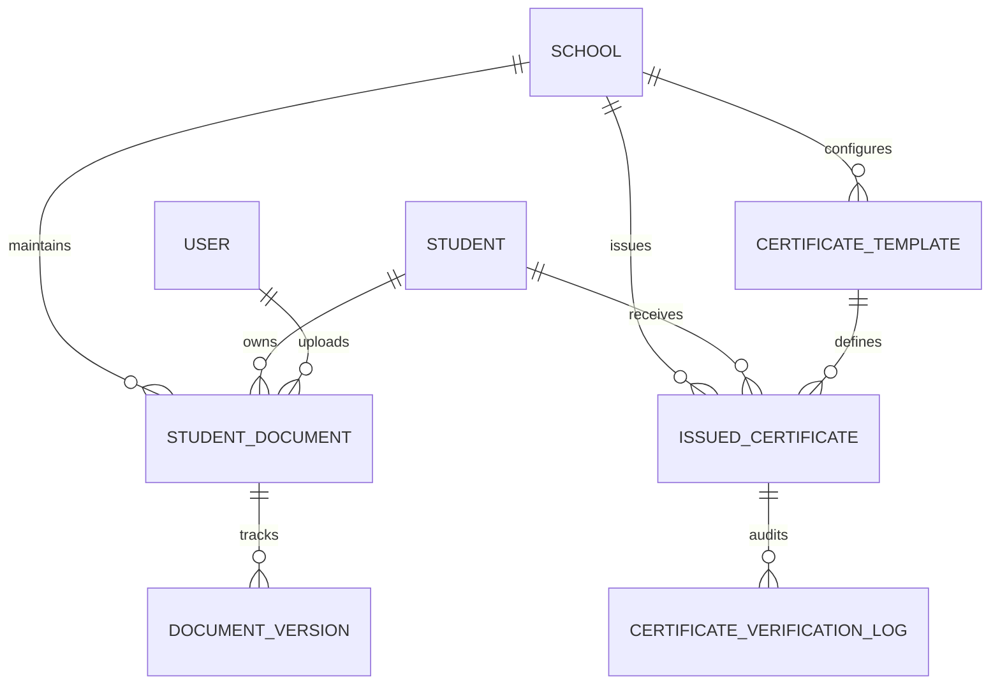
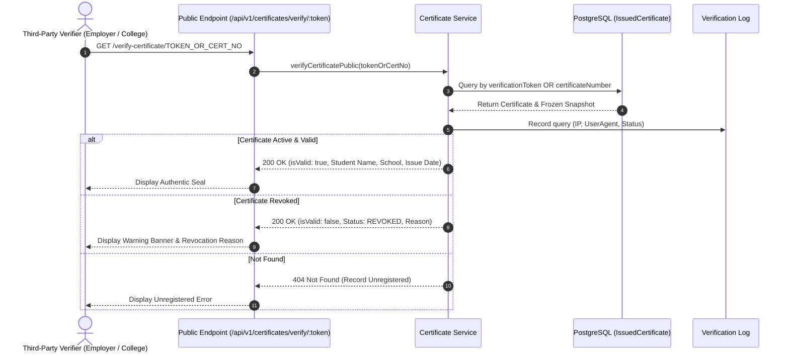

# Student Document & Certificate Management System

## 1. Architectural Overview

The **Student Document & Certificate Management System** in ShikshaTrack provides rural and urban educational institutions with a secure, centralized digital repository for student records and a tamper-evident digital certificate issuance engine.

### Core Capabilities
- **Student Document Repository:** Secure, multi-category document storage supporting Birth Certificates, Transfer Certificates, Identity Proofs (Aadhaar/Passport), Address Proofs, Academic Report Cards, and Medical Records.
- **Document Versioning:** Complete version history ($v_1 \rightarrow v_2 \rightarrow v_n$) preserving prior document revisions, uploaders, timestamps, and change justification notes.
- **Verification Workflow:** Multi-tier verification pipeline (`PENDING`, `VERIFIED`, `REJECTED`, `EXPIRED`) with administrative audit notes.
- **Vector PDF Certificate Generator:** Built-in standard PDF 1.4 vector generator producing high-resolution, printable institutional certificates with ornamental double borders, official watermark seals, institutional signatories, and dynamic placeholder interpolation.
- **Tamper-Evident QR Verification:** Every issued certificate embeds a vector-rendered QR code and a unique, non-guessable verification token enabling zero-login public authenticity verification via the ShikshaTrack National Educational Registry.
- **Administrative Revocation:** Revoke compromised or cancelled certificates with mandatory audit justifications while permanently updating public verification queries to reflect `REVOKED` status.
- **Strict Role-Based Isolation:** Enforces school-level tenant isolation and guardian-child access constraints (parents can only access records belonging to their linked children).

---

## 2. Database Models & Schema Design

### Models Summary

1. `StudentDocument`
   - Stores metadata, category (`BIRTH_CERTIFICATE`, `TRANSFER_CERTIFICATE`, `IDENTITY_PROOF`, `ADDRESS_PROOF`, `ACADEMIC_RECORD`, `MEDICAL_RECORD`, `OTHER`), verification status, current version pointer, SHA-256 integrity hash, issue date, and expiry date.
2. `DocumentVersion`
   - Immutable version record capturing `versionNumber`, physical file storage path, original filename, file size, MIME type, SHA-256 hash, uploader, and change reason.
3. `CertificateTemplate`
   - Reusable template specifications for Bonafide, Transfer, Character, Study, Fee Clearance, and Achievement certificates, with customizable body templates, signatory designations, and validity periods.
4. `IssuedCertificate`
   - Official certification record storing unique certificate number (`ST-YYYY-TYPE-SEQ`), secure verification token, frozen student snapshot JSON (preventing historical drift), signatory details, issue date, expiry date, status (`ACTIVE`, `REVOKED`), and revocation metadata.
5. `CertificateVerificationLog`
   - Audit trail capturing public verification queries, client IP addresses, user agents, query tokens, and validity results.

---

## 3. Vector PDF Generation Engine

The certificate rendering engine (`backend/src/utils/certificatePdfGenerator.js`) produces standard `%PDF-1.4` binary documents with zero external rendering dependencies:

1. **Standard Type 1 Fonts:** Employs standard PostScript fonts (`Helvetica`, `Helvetica-Bold`) recognized natively by all browser PDF viewers and print spoolers without font embedding overhead.
2. **Double Ornamental Borders:** Royal Navy (`#142E5C`) outer frame with double-stroke Imperial Gold (`#C79E2E`) inner border and corner embellishments.
3. **Dynamic Placeholder Replacement:** Automatically interpolates student particulars:
   - `{{student_name}}` &bull; Student legal name
   - `{{admission_no}}` &bull; Permanent institution admission sequence
   - `{{roll_no}}` &bull; Class roll number
   - `{{class_name}}` &bull; Enrolled grade & section
   - `{{guardian_name}}` &bull; Parent/guardian on record
   - `{{dob}}` &bull; Official date of birth
   - `{{academic_year}}` &bull; Academic calendar term
   - `{{school_name}}` &bull; Official institutional title
4. **Embedded Vector QR Code:** Compiles QR matrix modules directly into PDF vector drawing commands (`re f`), ensuring sharp printing at any DPI.

---

## 4. Public Verification & Security Protocol

### Safe Public Disclosure
Public verification responses deliberately omit sensitive student information (such as Aadhaar numbers, residential street addresses, and parent contact telephone numbers), providing only:
- Certificate authenticity status (`ACTIVE` vs `REVOKED`)
- Certificate number and title
- Student full name, admission number, and class
- Issuing school name and code
- Date of issue and signatory designation
- Revocation reason and date (if cancelled)

---

## 5. REST API Reference

### Student Documents (`/api/v1/documents`)
| Method | Endpoint | Roles | Description |
|---|---|---|---|
| `GET` | `/api/v1/documents/stats` | `ADMIN`, `TEACHER` | Retrieve document repository statistics |
| `GET` | `/api/v1/documents` | `ADMIN`, `TEACHER`, `PARENT` | List paginated documents with category & status filters |
| `POST` | `/api/v1/documents` | `ADMIN`, `TEACHER` | Upload student document and initialize version 1 |
| `GET` | `/api/v1/documents/:id` | `ADMIN`, `TEACHER`, `PARENT` | Get document metadata and version history |
| `GET` | `/api/v1/documents/:id/download` | `ADMIN`, `TEACHER`, `PARENT` | Stream document file (`?version=N` supported) |
| `POST` | `/api/v1/documents/:id/replace` | `ADMIN`, `TEACHER` | Upload replacement version ($v_{n+1}$) |
| `POST` | `/api/v1/documents/:id/verify` | `ADMIN`, `TEACHER` | Audit status (`VERIFIED`, `REJECTED`, `EXPIRED`) |
| `DELETE` | `/api/v1/documents/:id` | `ADMIN` | Permanently delete document and version files |

### Certificates Engine (`/api/v1/certificates`)
| Method | Endpoint | Roles | Description |
|---|---|---|---|
| `GET` | `/api/v1/certificates/verify/:tokenOrCertNo` | **PUBLIC** | Verify certificate authenticity without login |
| `GET` | `/api/v1/certificates/stats` | `ADMIN`, `TEACHER` | Retrieve certificate issuance statistics |
| `GET` | `/api/v1/certificates/templates` | `ADMIN`, `TEACHER` | List certificate templates (auto-seeds defaults) |
| `POST` | `/api/v1/certificates/templates` | `ADMIN` | Create custom certificate template |
| `PUT` | `/api/v1/certificates/templates/:id` | `ADMIN` | Update template layout and body boilerplate |
| `DELETE` | `/api/v1/certificates/templates/:id` | `ADMIN` | Delete or archive certificate template |
| `POST` | `/api/v1/certificates/issue` | `ADMIN`, `TEACHER` | Issue student certificate with snapshot |
| `GET` | `/api/v1/certificates` | `ADMIN`, `TEACHER`, `PARENT` | List issued certificates register |
| `GET` | `/api/v1/certificates/:id` | `ADMIN`, `TEACHER`, `PARENT` | Retrieve single issued certificate |
| `GET` | `/api/v1/certificates/:id/pdf` | `ADMIN`, `TEACHER`, `PARENT` | Generate and stream printable PDF certificate |
| `POST` | `/api/v1/certificates/:id/revoke` | `ADMIN` | Revoke certificate with mandatory audit reason |
