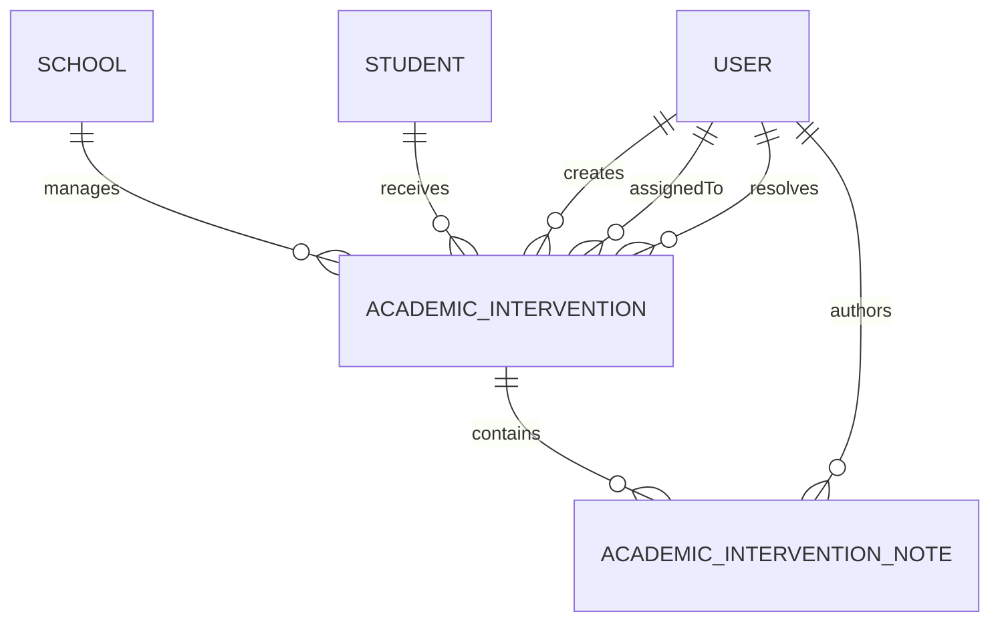

# Student Performance & Early Intervention Intelligence System

## 1. Architectural Overview

The **Student Performance & Early Intervention Intelligence System** in ShikshaTrack provides educators, school administrators, and guardians with predictive academic diagnostics, multi-dimensional score trends, statistical attendance-performance correlation, and an actionable early-warning intervention workflow.

### Core Capabilities
- **Predictive At-Risk Identification:** Evaluates holistic student performance across examination marks and attendance registers to classify students into stratified risk tiers (`CRITICAL`, `HIGH`, `MEDIUM`).
- **Statistical Attendance Correlation:** Computes the Pearson Correlation Coefficient ($r$) between longitudinal attendance percentages and cumulative exam scores, demonstrating the empirical relationship between classroom presence and test outcomes.
- **Examination Trend Analytics:** Chronological examination-to-examination trajectory analysis tracking individual and class score variations, identifying performance stagnation or sudden grade drops.
- **Subject-Wise Diagnostic Matrix:** Granular subject analytics including average score, pass percentage, standard deviation ($\sigma$), highest/lowest marks, and fail frequency.
- **Intervention Lifecycle Station:** Multi-stage workflow (`OPEN` $\rightarrow$ `IN_PROGRESS` $\rightarrow$ `ESCALATED` $\rightarrow$ `RESOLVED` / `CLOSED`) allowing teachers to create tailored action plans, set follow-up targets, append timestamped progress notes, and record resolution summaries.
- **Parent-Child Privacy Isolation:** Strict multi-tenant and role-based access control ensuring parents can only review their linked children's performance diagnostics while blocking access to school-wide aggregate registers.
- **Institutional CSV Reporting:** One-click tabular CSV report export summarizing student attendance, academic percentages, letter grades, risk statuses, and failing subjects for school audits.

---

## 2. Statistical & Risk Scoring Engine

### 2.1 Pearson Correlation Coefficient ($r$)

The module computes the Pearson product-moment correlation between student classroom attendance ($x$) and academic achievement ($y$):

$$r = \frac{n \sum xy - (\sum x)(\sum y)}{\sqrt{\left[n \sum x^2 - (\sum x)^2\right] \left[n \sum y^2 - (\sum y)^2\right]}}$$

Where:
- $n$ is the total count of evaluated students with active attendance and exam marks.
- $x_i$ is student $i$'s attendance percentage over the academic year.
- $y_i$ is student $i$'s cumulative percentage across all examination subjects.

#### Statistical Interpretation:
- $r > 0.6$: Strong positive correlation — regular classroom presence directly drives superior examination performance.
- $0.3 < r \le 0.6$: Moderate positive correlation — attendance is a significant predictor of academic success.
- $r \le 0.3$: Weak correlation — secondary factors (such as external tutoring or self-study) notably influence results.

### 2.2 Risk Stratification Rules

Students are flagged by the Early Warning Engine when meeting one or more critical thresholds:

| Risk Tier | Criteria | Automated Recommendation |
| :--- | :--- | :--- |
| **`CRITICAL`** | Overall score $< 33\%$ OR Score drop $\ge 20\%$ OR Attendance $< 60\%$ | Immediate parent consultation, mandatory remedial classes, and academic counselor assignment. |
| **`HIGH`** | Overall score $< 40\%$ OR Score drop $\ge 10\%$ OR Attendance $< 70\%$ | Peer mentoring, weekly homework checking, and targeted subject review. |
| **`MEDIUM`** | Score drop $\ge 5\%$ OR Failing in 1 subject OR Attendance $< 75\%$ | Diagnostic assessment, faculty check-in, and monitored study hours. |

---

## 3. Database Schema Design

### Models & Enums

#### `InterventionType`
`ACADEMIC_DEFICIT`, `EXAM_DECLINE`, `ATTENDANCE_CORRELATION`, `BEHAVIORAL`, `SUBJECT_SPECIFIC`, `OTHER`

#### `InterventionSeverity`
`LOW`, `MEDIUM`, `HIGH`, `CRITICAL`

#### `InterventionStatus`
`OPEN`, `IN_PROGRESS`, `RESOLVED`, `ESCALATED`, `CLOSED`

#### `AcademicIntervention`
- `id`: UUID Primary Key
- `schoolId`: Institutional tenant identifier
- `studentId`: Foreign key to `Student`
- `teacherId`: User ID of initiator
- `assignedToId`: User ID of responsible mentor/teacher
- `resolvedById`: User ID of resolving authority
- `type`: `InterventionType` enum
- `severity`: `InterventionSeverity` enum
- `status`: `InterventionStatus` enum
- `title`: Short intervention objective
- `description`: Diagnostic reasoning and background
- `subject`: Targeted subject (e.g. "Mathematics")
- `actionPlan`: Detailed remedial steps
- `baselinePercentage`: Academic percentage at initiation
- `currentPercentage`: Running progress percentage
- `targetPercentage`: Milestone percentage to achieve
- `baselineAttendance`: Attendance rate at initiation
- `followUpDate`: Scheduled review deadline
- `resolvedAt`: Timestamp of resolution
- `resolutionNotes`: Final outcome documentation

#### `AcademicInterventionNote`
- `id`: UUID Primary Key
- `interventionId`: Foreign key to `AcademicIntervention`
- `authorId`: Foreign key to `User`
- `note`: Longitudinal observation or milestone update
- `createdAt`: Timestamp

---

## 4. API Reference

All endpoints are mounted under `/api/v1/performance`.

| Method | Endpoint | Access Roles | Description |
| :--- | :--- | :--- | :--- |
| `GET` | `/overview` | `ADMIN`, `TEACHER` | Institutional KPIs (average percentage, pass rate, at-risk count, grade distribution). |
| `GET` | `/subjects` | `ADMIN`, `TEACHER` | Subject-wise performance metrics, standard deviations, highest/lowest marks. |
| `GET` | `/trends` | `ADMIN`, `TEACHER` | Chronological exam-to-exam performance trajectories and delta percentages. |
| `GET` | `/classes` | `ADMIN`, `TEACHER` | Comparative academic analytics across classes and sections. |
| `GET` | `/at-risk` | `ADMIN`, `TEACHER` | Paginated register of at-risk students with configurable threshold query filters. |
| `GET` | `/correlation` | `ADMIN`, `TEACHER` | Pearson correlation coefficient and attendance-marks quartile breakdown. |
| `GET` | `/export` | `ADMIN`, `TEACHER` | Download full institutional performance register as CSV. |
| `GET` | `/students/:id` | `ADMIN`, `TEACHER`, `PARENT` | Comprehensive individual student drilldown. Parents restricted to linked children. |
| `GET` | `/interventions` | `ADMIN`, `TEACHER`, `PARENT` | Paginated intervention records with filtering by status, severity, and student. |
| `POST` | `/interventions` | `ADMIN`, `TEACHER` | Create new academic intervention record. |
| `PUT` | `/interventions/:id` | `ADMIN`, `TEACHER` | Update intervention details, action plan, or lifecycle status. |
| `POST` | `/interventions/:id/resolve` | `ADMIN`, `TEACHER` | Mark intervention as resolved with comprehensive resolution notes. |
| `POST` | `/interventions/:id/notes` | `ADMIN`, `TEACHER` | Append timestamped progress observation to an active intervention. |

---

## 5. Security & Multi-Tenancy Isolation

1. **School Multi-Tenancy:** All queries and updates enforce `where: { schoolId: req.user.schoolId }`. Cross-institutional data access is cryptographically and relationally blocked.
2. **Guardian Privacy Guard:** In `getStudentPerformanceDrilldown`, when `req.user.role === 'PARENT'`, the user's `parentProfile.students` array is cross-referenced against the requested `studentId`. If the requested child does not belong to the guardian, the request is aborted with `403 Forbidden` (`Unauthorized: You can only view performance data for your linked children`).
3. **Audit Trails:** Resolving interventions or logging progress notes preserves permanent author associations via relational foreign keys and immutable timestamps.
